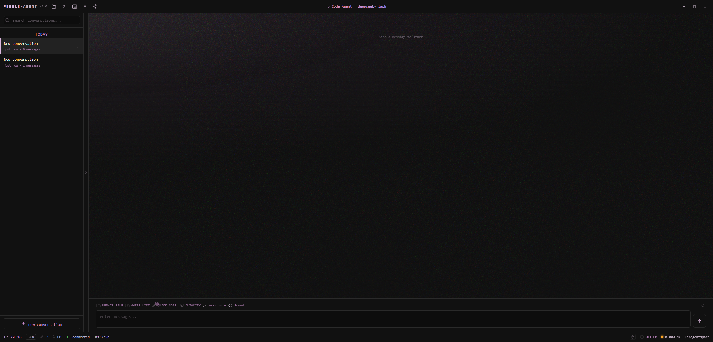
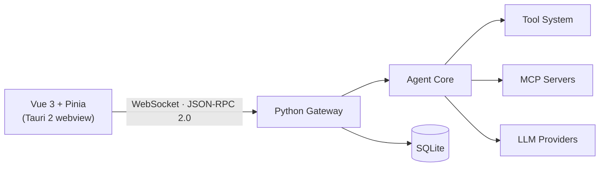

<div align="center">


**An open-source, extensible desktop AI agent with tools, skills, MCP servers, a self-maintained code knowledge base, and cross-session memory.**

[](https://github.com/5235aa-web/pebbleagent/actions/workflows/checks.yml)
[](LICENSE)
[](https://www.python.org/)
[](https://vuejs.org/)
[](https://tauri.app/)
[](#)

</div>

> **Platform support:** Windows 10/11 (64-bit) only, for now. The app and its backend rely on Windows APIs (process management, PowerShell integration, packaging), so Linux and macOS are not supported yet.

## Features

- **Code Knowledge Base (CKB).** The agent indexes your repository into a chaptered knowledge base, verifies it against the source, and keeps it in sync as the project evolves.
- **Cross-session experience ledger.** Corrections, constraints, and preferences you express during work become evidence-backed entries in a local SQLite ledger. Later turns recall the relevant ones by full-text relevance plus tool and path context, and superseded entries are retired automatically. Capture and recall run on rules, not extra model calls.
- **Snapshot & rollback.** Every write is snapshotted before it happens; diffs are tracked per file, and you can roll back a single file or an entire change set — with an undo for the rollback itself.
- **Permission & audit system.** Three permission modes (manual, auto, read-only), rule sets with `tool:pattern` matching, a path whitelist, fail-closed checks, and a tamper-evident audit log (chained checksums) for every sensitive operation.
- **Skills and MCP servers.** 120 bundled skills load on demand; MCP servers over stdio, SSE, HTTP, or WebSocket are installed with sha256 verification and approved per project.
- **Real-time cost tracking.** Per-model pricing with peak/off-peak tiers (including Chinese statutory holidays) and cache-hit accounting, updated live per conversation.
- **HTML preview with feedback bridge.** Generated HTML pages render in a sandboxed preview; click any element to leave a comment, and the agent iterates on the page from your annotations.
- **Streaming agent chat with full execution visibility.** Reasoning, tool calls, file changes, and results unfold as a step-by-step timeline instead of a black box.
- **Full UI theming.** Pick any color and the whole palette adapts instantly across the entire interface.
- **Desktop-grade shell.** A frameless Tauri 2 window, a WebSocket JSON-RPC 2.0 protocol, and a self-contained Python backend shipped as a sidecar.

## Screenshots



## Architecture



## Getting Started

### Prerequisites

- Windows 10/11 (64-bit), the only supported platform for now
- Python 3.11+
- Node.js 18+ (for the frontend and npx-based MCP servers)
- Rust toolchain (only needed to build the desktop shell)

### Run from source

```bash
git clone <your-repo-url>
cd <repo-folder>

pip install -r requirements.txt

cd ui-gui-vue3
npm install
cd ..
```

`requirements.txt` is the core set — enough to start the backend and chat. PDF
reading and image OCR are optional and lazy-imported; install them with
`pip install -r requirements-optional.txt` when you need those tools.

Then launch both services with the provided script:

```bash
start_gui.bat
```

This starts the Python backend (`ws://127.0.0.1:19876`) and the Vite dev server (`http://localhost:5174`).

To run the desktop shell in development instead, start the backend first and then:

```bash
cd ui-gui-vue3
npx tauri dev
```

### Build the desktop app

1. Package the backend with PyInstaller:

```bash
pyinstaller pebble-backend.spec
```

2. Copy the artifact next to the Tauri shell (sidecar naming requires the target triple):

```bash
copy dist\pebble-backend.exe ui-gui-vue3\src-tauri\binaries\pebble-backend-x86_64-pc-windows-msvc.exe
```

3. Build the desktop bundle:

```bash
cd ui-gui-vue3
npx tauri build
```

## Configuration

All runtime data lives in `%USERPROFILE%\.pebble\` (override with the `PEBBLE_HOME` environment variable).

- **LLM providers** — providers, API keys, models, and reasoning effort are configured in `llm_providers.json` or from the in-app settings.
- **MCP servers** — the MCP panel installs and manages servers; tokens and executable paths are stored in `~/.pebble/.mcp.json`.
- **Permissions** — modes and `tool:pattern` rules live in `permission_rules.json`; the path whitelist in `path_whitelist.json`.
- **Pricing** — the per-model price table (with peak/off-peak tiers) is in `model_pricing.json`; holiday data in `cn_holidays.json`.

## Project Structure

```
gateway/          Python WebSocket gateway (JSON-RPC, sessions, permissions)
agent_core/       Agent core (chat service, tool orchestration, experience ledger, snapshots)
tools/            Built-in tools
skills/           Bundled skills
knowledgesource/  Code knowledge base (chaptered)
ui-gui-vue3/      Vue 3 frontend + Tauri 2 desktop shell
tests/            Standalone verification tests (python tests/run_all.py)
```

## Tests

Standalone verification tests live in `tests/` and need no framework — each file runs on its own and exits non-zero on failure:

```bash
python tests/run_all.py    # Python tests (tool policy, compaction, billing, ...)
node tests/run_all.mjs     # JS tests (fold algorithm, WS recovery, UI formulas, ...)
```

Three billing/holiday regression scripts (`peb_check_*.py`) sit at the repo root and follow the same exit-code convention. All of the above, plus a full `compileall` syntax check and a `vue-tsc` type check, run in CI on every push (`.github/workflows/checks.yml`).

## Credits

PebbleAgent bundles 120 skills. Third-party skills and materials
(10 Apache-2.0 skills, 3 MIT skills, 1 reference set) are listed in
[THIRD_PARTY_NOTICES.md](THIRD_PARTY_NOTICES.md).

Video rendering (the `brag` skill) is powered by
[HyperFrames](https://github.com/heygen-com/hyperframes), Copyright 2026
HeyGen, Inc., licensed under Apache-2.0.

## License

Licensed under the [GNU Affero General Public License v3.0](LICENSE).
