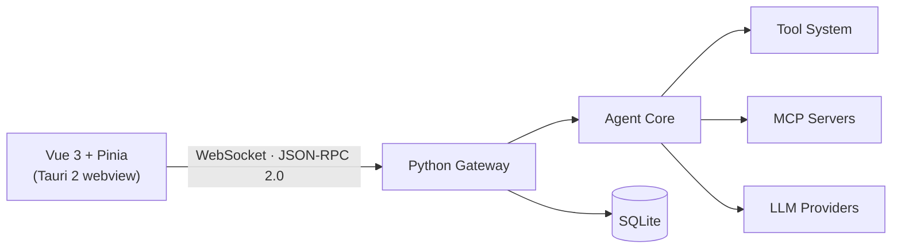

<div align="center">


**An open-source, extensible desktop AI agent with tools, skills, MCP servers, and a self-maintained code knowledge base.**

[](LICENSE)
[](https://www.python.org/)
[](https://vuejs.org/)
[](https://tauri.app/)
[](#)

</div>

## Features

- **Streaming agent chat with full execution visibility.** Reasoning, tool calls, file changes, and results unfold as a step-by-step timeline instead of a black box.
- **Built-in tool system.** File read/write/edit, search, shell commands, to-do tracking, and clarifying questions, each audited and gated by the permission layer.
- **Snapshot & rollback.** File changes are tracked with diffs, so you can roll back a single file or all changes at once.
- **On-demand skills.** 100+ bundled skill folders covering design, debugging, TDD, Office documents, 3D workflows, and more, loaded only when a task needs them.
- **Code Knowledge Base (CKB).** The agent indexes your repository into a chaptered knowledge base, verifies it against the source, and keeps it in sync as the project evolves.
- **Cross-session memory.** Persistent agent memory and user notes are injected into context, so preferences and project facts survive between sessions.
- **Context compaction.** Automatic and manual compaction summarize long conversations without losing the thread, and folded history stays inspectable.
- **Real-time cost tracking.** Per-model pricing with peak/off-peak tiers and cache-hit accounting, updated live per conversation.
- **Permission controls.** Allow / deny / ask rule sets, a path whitelist, and an audit log for every sensitive operation.
- **Full UI theming.** Pick any color and the whole palette adapts instantly across the entire interface.
- **Desktop-grade shell.** A frameless Tauri 2 window, a WebSocket JSON-RPC 2.0 protocol, and a self-contained Python backend shipped as a sidecar.

## Screenshots


## Architecture



## Getting Started

### Prerequisites

- Windows 10/11
- Python 3.10+
- Node.js 18+ (for the frontend and npx-based MCP servers)
- Rust toolchain (only needed to build the desktop shell)

### Run from source

```bash
git clone <your-repo-url>
cd <repo-folder>

pip install -r requirements.txt

cd ui-gui-vue3
npm install
cd ..
```

Then launch both services with the provided script:

```bash
start_gui.bat
```

This starts the Python backend (`ws://127.0.0.1:19876`) and the Vite dev server (`http://localhost:5174`).

To run the desktop shell in development instead, start the backend first and then:

```bash
cd ui-gui-vue3
npx tauri dev
```

### Build the desktop app

1. Package the backend with PyInstaller:

```bash
pyinstaller pebble-backend.spec
```

2. Copy the artifact next to the Tauri shell (sidecar naming requires the target triple):

```bash
copy dist\pebble-backend.exe ui-gui-vue3\src-tauri\binaries\pebble-backend-x86_64-pc-windows-msvc.exe
```

3. Build the desktop bundle:

```bash
cd ui-gui-vue3
npx tauri build
```

## Configuration

All runtime data lives in `%USERPROFILE%\.pebble\` (override with the `PEBBLE_HOME` environment variable).

- **LLM providers** — providers, API keys, models, and reasoning effort are configured in `llm_providers.json` or from the in-app settings.
- **MCP servers** — the MCP panel installs and manages servers; tokens and executable paths are stored in `~/.pebble/.mcp.json`.
- **Permissions** — allow / deny / ask rules live in `permission_rules.json`; the path whitelist in `path_whitelist.json`.
- **Pricing** — the per-model price table (with peak/off-peak tiers) is in `model_pricing.json`; holiday data in `cn_holidays.json`.

## Project Structure

```
gateway/          Python WebSocket gateway (JSON-RPC, sessions, permissions)
agent_core/     Agent core (chat service, tool orchestration, memory, snapshots)
tools/            Built-in tools
skills/           Bundled skills
knowledgesource/  Code knowledge base (chaptered)
ui-gui-vue3/      Vue 3 frontend + Tauri 2 desktop shell
```

## License

Licensed under the [GNU Affero General Public License v3.0](LICENSE).
